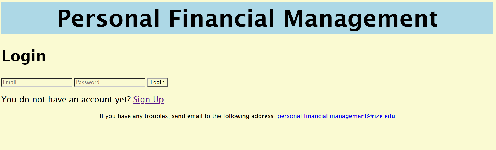
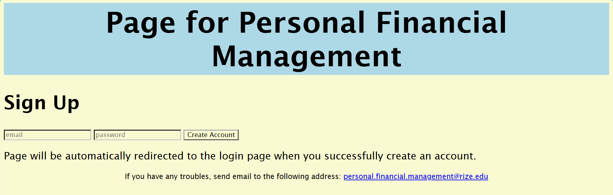
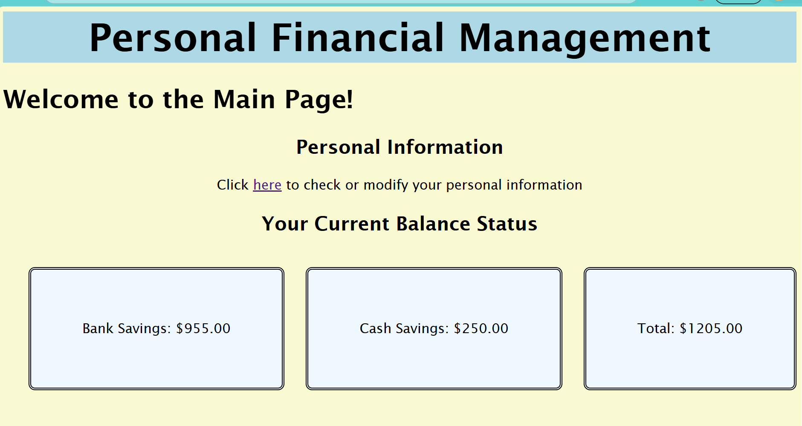
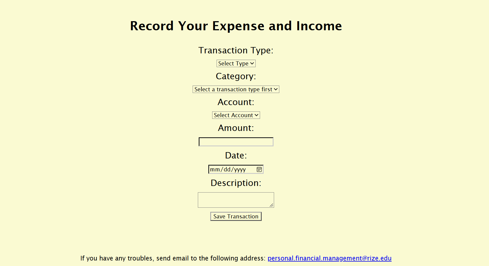
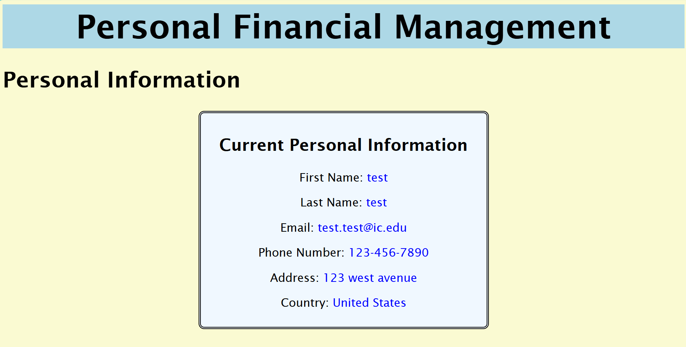
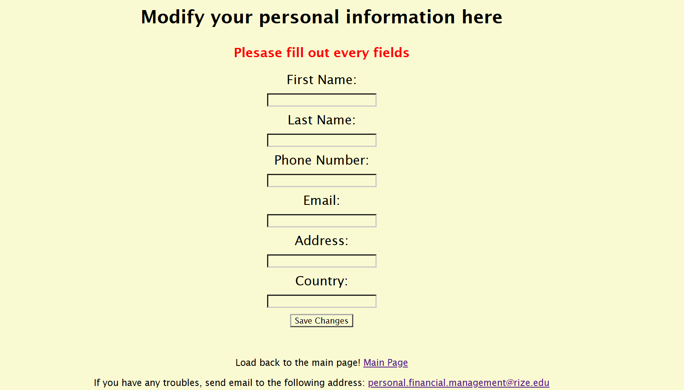
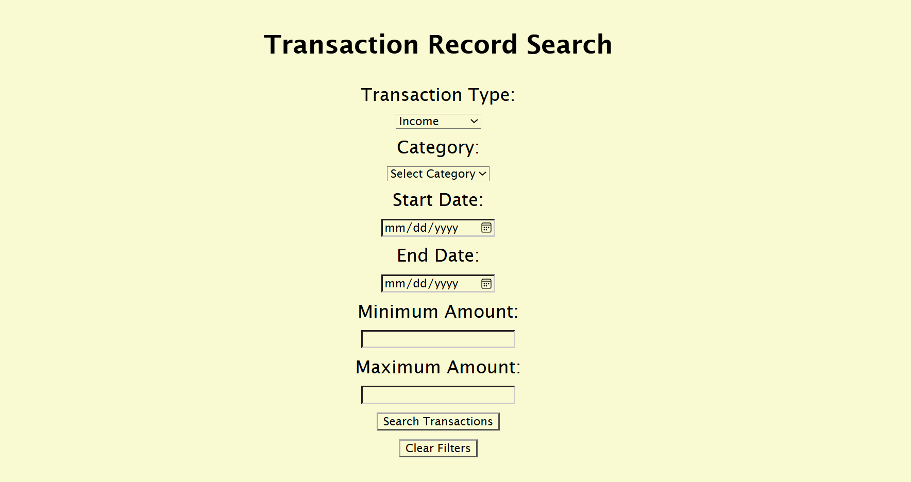
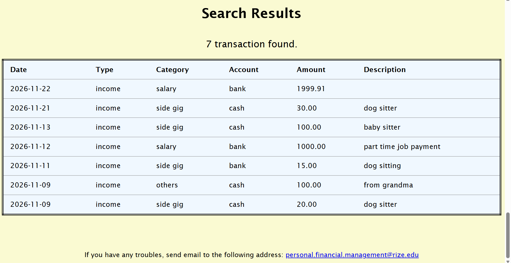
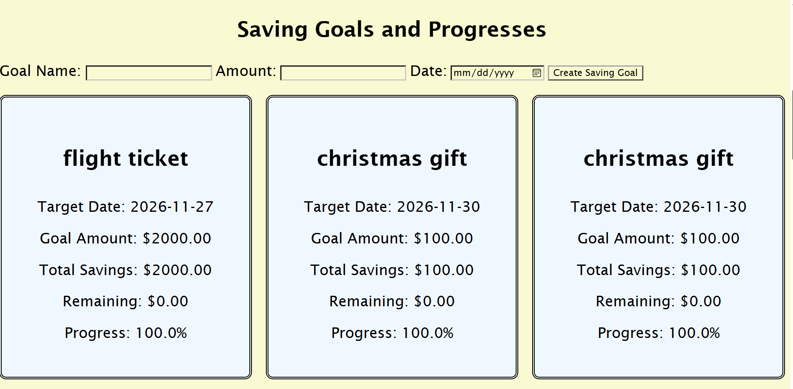

# managing-personal-finance-project
This application will help user managing their personal finance.
The application solves the problem that many students and young adults face regarding their personal financial management. By building a complete system from user authentication to financial tracking to solve a real-world problem

**Note**
- Logout has not implemented yet.
- Layout adjustment for the smaller window has not implemented yet.
- The application currently uses SQLite on Render's free subscription plan, which does not provide persistent disk storage. As a result, user accounts and financial data may be lost when the service spins down after inactivity, or is redeployed. Users may need to register again and re-enter their information. However, while the service is running and the database remains available, all implemented features function as expected.
- Unit tests use mocks.

## Live Application
- Frontend(deployed website): https://managing-personal-finance-project.onrender.com
- Backend: https://managing-personal-finance-project-web.onrender.com
- Github: https://github.com/nori0507/managing-personal-finance-project

## Features and Usage Examples
- Sign up: Open the signup page, enter an email and password, and create an account. 
- Login: Enter registered credentials on the login page to access the main page of application. 
- Manage personal information: View and edit your personal information. 
- Record transactions: Enter the transaction details to update the transaction record table. 
- View balances: Calculate the balabces in each bank and cash accont and display them. 
- Transaction Record Search: You can use filters to search your transaction history
- Saving goals: Users can create saving goals and the progress and goal details willbe displayed.

## Local Set Up
### Prerequisites
Install Node.js, npm, Git, and a code editor such as VS Code(This instructionis using the VS Code).

### 1. Clone the repository to your computer and open the project throught the path.
### 2. Configure environment variables
Create a `.env` file in the project root:
```
NODE_ENV=development
FRONTEND_URL=http://127.0.0.1:5500
SESSION_SECRET=replace-with-a-long-random-secret
```

### 3. Start the backend
```
node api-service.js
```
### 4. Start the frontend
Open `index.html` with VS Code Live Server. The page will be redirected to the login page right after.


### Troubleshooting
- `node api-service.js` does not start: Confirm `npm install` completed, `.env` exists, and port 3000 is available. 
- Frontend requests fail: Confirm the backend is running, the API base URL is correct, and `FRONTEND_URL` exactly matches the browser's frontend origin. 

## Technology Used in the Application
- Frontend: HTML, CSS, JavaScript -- Pages, interactions, and API requests 
- Backend: Node.js, Express -- API endpoints and server logic 
- Database: SQLite, Sequelize -- Data storage and Database construction 
- Authentication: bcryptjs, express-session -- Password hashing and session-based login 
- Testing: Jest -- Unit tests 
- CI: GitHub Actions -- Run automated tests on pushes and pull requests 
- Hosting: Render -- frontend(static) and backend(web service) 

## Project Structure
```
managing-personal-finance-project/
|-- index.html                         # Deployed entry page, redirect itself tothe login.html
|-- mainpage.html                      # Main page after login
|-- login.html                         # Login page
|-- signup.html                        # Registration page
|-- personalinfo.html                  # Personal information page
|-- styles.css                         # Frontend styling
|-- login.js                            # Login interactions and API calls
|-- signup.js                           # Registration interactions and API calls
|-- personal-info.js                    # Personal information logic
|-- financial-management-function.js    # Financial management (main page) logic
|-- api-service.js                      # Express backend and database API
|-- __test__/                           # Jest tests
|-- jest.config.js                      # Jest configuration
|-- package.json                        # Dependencies and npm scripts
|-- package-lock.json                   # Locked dependency versions
|-- .github/workflows/ci.yml           # CI workflow
|-- .gitignore                          # Spacify the file that should not be commited to the github
```
`database.sqlite` and `.env` is created or used locally by the application and should not be committed to GitHub.

## Design Pattern
The application follows an **MVC** design pattern

- Model: Sequelize models represent users, personal information, and financial data and interact with SQLite.
- View: HTML and CSS render the interface; frontend JavaScript updates displayed content.
- Controller: Express route handlers validate and process API requests, interact with models, and return responses. Frontend JavaScript handles form events and communicates with the API.

This separation makes the interface, data access, and business logic easier to understand and test. 

The application also utilized the **Observer** design pattern for the following:

The Observer Design Pattern was implemented to automatically update multiple components of the personal financial management application whenever a new transaction is recorded.
- Subject: TransactionSystem class
- Observer: BalanceObserver and SavingGoalObserver classes

When a user successfully records a transaction, the subject calls the notify() method, which informs all registered observers. Each observer then executes its own update() method. The BalanceObserver retrieves and displays the updated account balances, while the SavingGoalObserver retrieves and displays the updated savings goal information.

## Technical Decisions
- Express API: Separates front end and backend so that browser does not access tp thedatabase directly.
- Sequelize + SQLite: Simplifies local development; However, SQLite is not ideal for persistence when it comes to deployment 
- Session-based authentication: Backend can identify the logged-in user and return only the records associated with that user's account
- Environment-specific configuration: Allows the use of the same application code in both environments(local and Render) without manually rewriting URLs and cookie settings.

## Unit tests
Run the unit tests locally:
```
npm test
```
The Jest suite covers successful and unsuccessful login, signup, personal information updates and retrieval, category updates, transaction saving, balance retrieval, and display-related behavior.

Tests mock API responses and check expected function behavior. Passing unit tests does not prove that the deployed frontend, backend, database, and cookies work together; manual end-to-end verification is also necessary.

## Screenshots
### Login page


### Signup page


### Main page



### Personal information page



### Transaction Search



### Saving Goals


## Deployment
The frontend is deployed as a Render Static Site and the Express backend as a Render Web Service. The deployed frontend calls the deployed backend API over HTTPS.

Production environment settings includes `SESSION_SECRET`, `FRONTEND_URL`, `NODE_ENV=production`. `FRONTEND_URL` will be different for frontend and backend. For the Static Site(frontend), you can use the value that is in your local .env file while you have to use the Static Site render URL for the Web Service's(backend) `FRONTEND_URL` variable.